# Noxway Platform — Diagrama de Clases y Modelo de Dominio

> El diagrama completo en formato PlantUML se encuentra en [class-diagram.puml](class-diagram.puml). A continuación se presenta la vista modular en Mermaid compatible con GitHub.

## 1. Vista de Agregados por Bounded Context (DDD)

```mermaid
classDiagram
  direction LR

  namespace SharedKernel {
    class AbstractDomainAggregateRoot {
      <<abstract>>
      -List~Object~ domainEvents
      #registerEvent(Object event)
      +domainEvents() List~Object~
      +clearDomainEvents()
    }
    class Coordinate {
      <<ValueObject>>
      +double latitude
      +double longitude
      +distanceKmTo(double lat, double lng) double
    }
    class Result~T,E~ {
      <<Sealed Interface>>
      +success(T value)
      +failure(E error)
    }
  }

  namespace ProfilesAndTrustNetwork {
    class UserAccount {
      <<AggregateRoot>>
      -UUID id
      -String email
      -String fullName
      -String phone
      -String role
      -String shiftType
      -String shiftStart
      -String shiftEnd
      -String timeZone
      +updateProfile(...)
    }
    class TrustLink {
      <<AggregateRoot>>
      -UUID id
      -UUID workerId
      -UUID contactId
      -String status
      +accept(UUID actorId)
      +reject(UUID actorId)
      +revoke(UUID actorId)
    }
    class NotificationPreference {
      <<AggregateRoot>>
      -UUID id
      -UUID accountId
      -String channel
      -boolean enabled
      -String priorityStart
      -String priorityEnd
    }
  }

  namespace CommutingAndAlerts {
    class Commute {
      <<AggregateRoot>>
      -UUID id
      -UUID workerId
      -String origin
      -String destination
      -String transport
      -Instant startTime
      -Instant estimatedArrivalTime
      -int toleranceMinutes
      -String status
      +delay(int minutes)
      +markOverdue()
      +arrive(Instant arrivedAt)
    }
    class TelemetryPing {
      <<AggregateRoot>>
      -UUID id
      -UUID commuteId
      -double latitude
      -double longitude
      -double speed
      -Instant recordedAt
    }
    class SafetyIncident {
      <<AggregateRoot>>
      -UUID id
      -UUID commuteId
      -UUID workerId
      -String type
      -String description
      -String status
      +resolve(Instant resolvedAt)
    }
    class AlertNotification {
      <<AggregateRoot>>
      -UUID id
      -UUID commuteId
      -UUID workerId
      -UUID contactId
      -String channel
      -String status
      -int attempts
      +markDelivered(Instant at)
      +markFailed(String err, Instant nextRetry)
    }
  }

  namespace CommunityAndMap24h {
    class ServicePoint {
      <<AggregateRoot>>
      -UUID id
      -String name
      -String type
      -double latitude
      -double longitude
      -String status
      -int trustScore
      -UUID reportedBy
      +applyModerationDecision(boolean approved)
      +recalculateTrustScore(int score)
    }
    class ServiceOpeningInterval {
      <<AggregateRoot>>
      -UUID id
      -UUID serviceId
      -int dayOfWeek
      -String opensAt
      -String closesAt
      -boolean closesNextDay
      -boolean open24Hours
    }
    class ServiceVote {
      <<AggregateRoot>>
      -UUID id
      -UUID serviceId
      -UUID accountId
      -int direction
    }
    class RiskZone {
      <<AggregateRoot>>
      -UUID id
      -UUID reportedBy
      -String description
      -String riskLevel
      -double latitude
      -double longitude
      -String status
      +resolve()
    }
    class CommunityPost {
      <<AggregateRoot>>
      -UUID id
      -UUID authorId
      -String title
      -String content
      -String district
      -String category
      -Double latitude
      -Double longitude
    }
    class RouteRating {
      <<AggregateRoot>>
      -UUID id
      -UUID commuteId
      -UUID workerId
      -int score
      -String comments
    }
  }

  namespace WellnessAndSleep {
    class RestSession {
      <<AggregateRoot>>
      -UUID id
      -UUID workerId
      -Instant startTime
      -Instant endTime
      -long durationMinutes
      -int quality
      -String notes
    }
    class SleepGoal {
      <<AggregateRoot>>
      -UUID workerId
      -int targetMinutes
    }
  }

  namespace SubscriptionsAndReferrals {
    class SubscriptionPlan {
      <<AggregateRoot>>
      -UUID id
      -String code
      -String name
      -BigDecimal monthlyPrice
      -int maxContacts
      -int maxWorkers
    }
    class Subscription {
      <<AggregateRoot>>
      -UUID id
      -UUID ownerId
      -UUID planId
      -String status
      -Instant endsAt
      +activate(Instant now)
      +extendDays(int days)
      +cancel()
    }
    class SubscriptionPayment {
      <<AggregateRoot>>
      -UUID id
      -UUID subscriptionId
      -UUID workerId
      -BigDecimal amount
      -String status
      -String reference
      +confirmOffline(String ref, UUID adminId)
      +reject(UUID adminId)
    }
    class SubscriptionMember {
      <<AggregateRoot>>
      -UUID id
      -UUID subscriptionId
      -UUID workerId
      -String status
    }
    class CollectiveBenefit {
      <<AggregateRoot>>
      -UUID id
      -String name
      -String planCode
    }
    class BenefitClaim {
      <<AggregateRoot>>
      -UUID id
      -UUID benefitId
      -UUID workerId
      -String code
    }
  }

  namespace ModerationAndGovernance {
    class ModerationReport {
      <<AggregateRoot>>
      -UUID id
      -String targetType
      -UUID targetId
      -UUID reporterId
      -String status
      +decide(boolean approved)
    }
    class ModerationAction {
      <<AggregateRoot>>
      -UUID id
      -UUID reportId
      -UUID moderatorId
      -String decision
      -String notes
    }
  }

  UserAccount "1" --> "*" TrustLink : workerId / contactId
  UserAccount "1" --> "*" NotificationPreference : accountId
  Commute "1" --> "*" TelemetryPing : commuteId
  Commute "1" --> "*" SafetyIncident : commuteId
  Commute "1" --> "*" AlertNotification : commuteId
  ServicePoint "1" --> "*" ServiceOpeningInterval : serviceId
  ServicePoint "1" --> "*" ServiceVote : serviceId
  Commute "1" --> "0..1" RouteRating : commuteId
  SubscriptionPlan "1" --> "*" Subscription : planId
  Subscription "1" --> "*" SubscriptionPayment : subscriptionId
  Subscription "1" --> "*" SubscriptionMember : subscriptionId
  CollectiveBenefit "1" --> "*" BenefitClaim : benefitId
  ModerationReport "1" --> "*" ModerationAction : reportId
```

## 2. Comunicación entre Contextos mediante Anti-Corruption Layer (ACL)

| Facade Expuesta (`interfaces.acl`) | Contexto Proveedor | Contextos Consumidores | Propósito |
|---|---|---|---|
| `IamContextFacade` | `iam` | Todos los contextos | Resuelve el `Actor(id, role)` activo desde `X-Actor-Id` o contexto de seguridad |
| `ProfileDirectoryFacade` | `profiles` | `commuting`, `community`, `subscriptions` | Consulta nombres, correos, roles y vínculos de confianza activos (`TrustLink`) |
| `SubscriptionAllowanceFacade` | `subscriptions` | `profiles` | Valida el límite máximo de contactos permitidos por el plan activo (`ESSENTIAL`: 1, `SENTINEL_PRO`: 5, `FAMILY_CREW`: 5) |
| `CommuteVerificationFacade` | `commuting` | `community` | Verifica que un trayecto pertenezca al trabajador y esté en estado `ARRIVED` antes de permitir `RouteRating` |
| `ModerationQueueFacade` | `moderation` | `community` | Encola automáticamente nuevos `ServicePoint` y `RiskZone` para revisión administrativa |
| `CommunityTargetGovernanceFacade` | `community` | `moderation` | Aplica la decisión `APPROVE` / `REJECT` del moderador sobre el `ServicePoint` o `RiskZone` |
