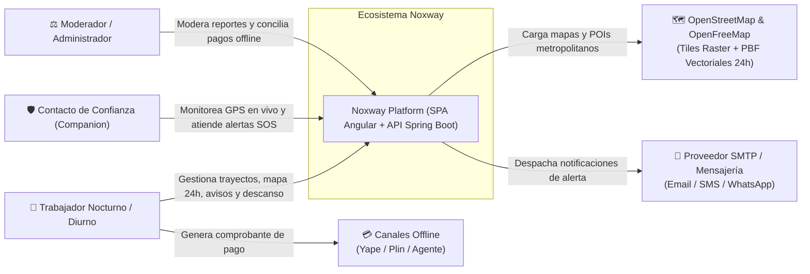
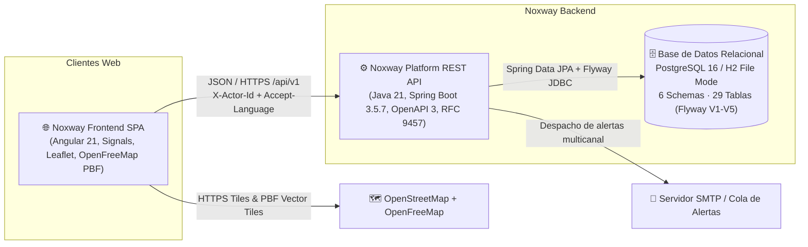
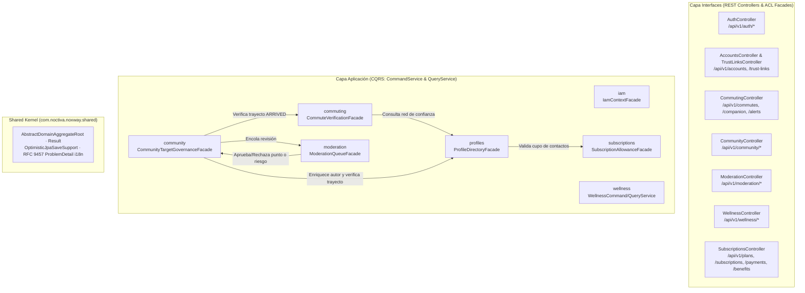

# Noxway Platform — Arquitectura de Software (C4, DDD & Esquemas de Base de Datos)

> La definición formal en Structurizr DSL se encuentra en [software-architecture.dsl](software-architecture.dsl). Este documento presenta las vistas arquitectónicas C4, el diseño en 4 capas DDD/CQRS y la distribución física de las 29 tablas en 6 esquemas.

---

## 1. Diagrama de Contexto del Sistema (C4 Nivel 1)

---

## 2. Diagrama de Contenedores (C4 Nivel 2)

---

## 3. Diagrama de Componentes y Bounded Contexts (C4 Nivel 3)

Cada Bounded Context aplica estrictamente las **4 capas de DDD** (`domain`, `application`, `infrastructure`, `interfaces`) y se comunica con otros contextos únicamente mediante **Facades ACL (`*Facade`)**:

---

## 4. Distribución de Esquemas y Tablas en Base de Datos (Flyway `V1` – `V5`)

La base de datos evita tablas monolíticas dividiendo las **29 tablas** en **6 esquemas de dominio** más el historial de Flyway:

| Esquema | Tablas (`29` en total) | Propósito |
|---|---|---|
| `users_network_schema` (5) | `user_accounts`, `trust_links`, `notification_preferences`, `auth_sessions`, `password_reset_tokens` | Cuentas de trabajadores/contactos/admins, vínculos de confianza, preferencias por canal y sesiones IAM |
| `commute_incident_schema` (4) | `commutes`, `telemetry_pings`, `safety_incidents`, `alert_notifications` | Trayectos activos/históricos, pings GPS con velocidad, incidentes SOS y cola de despacho multicanal |
| `community_data_schema` (6) | `service_points`, `service_opening_intervals`, `service_votes`, `risk_zones`, `route_ratings`, `community_posts` | Locales 24h, horarios por día de semana, votos `+1`/`-1`, zonas de riesgo, calificación de rutas y avisos con categoría y coordenadas OSM |
| `wellness_schema` (2) | `rest_sessions`, `sleep_goals` | Bitácora de sueño sin solapamientos y meta diaria personalizada (`240`–`720` min) |
| `subscription_schema` (9) | `subscription_plans`, `subscriptions`, `subscription_members`, `subscription_payments`, `collective_benefits`, `benefit_claims`, `referral_codes`, `referral_redemptions`, `referral_rewards` | Catálogo de planes, membresías, grupo familiar `FAMILY_CREW`, pagos offline con recibo único, cupones y referidos |
| `moderation_schema` (2) | `moderation_reports`, `moderation_actions` | Cola de moderación y auditoría inmutable de decisiones administrativas |
| `public` (1) | `flyway_schema_history` | Control de versiones de migraciones SQL (`V1` a `V5`) |
